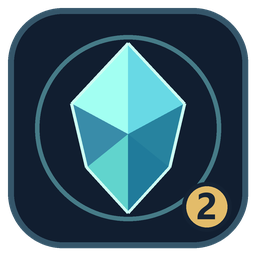
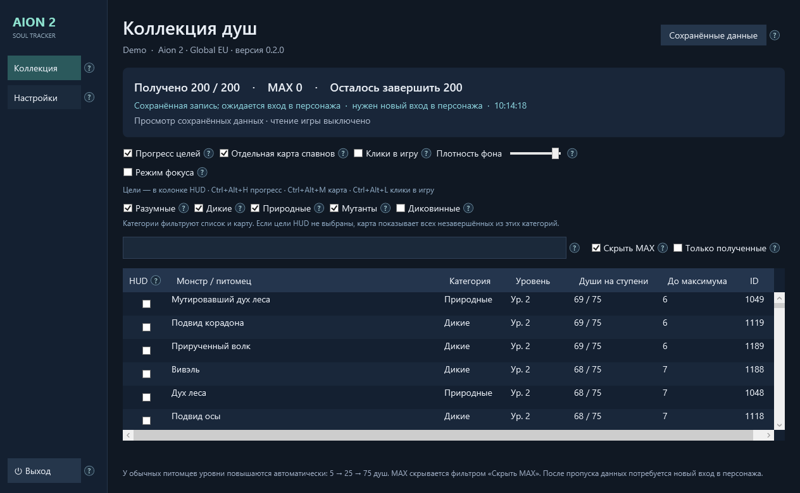
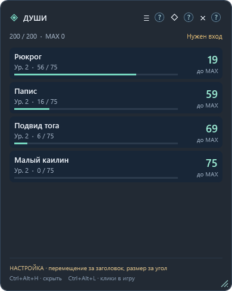
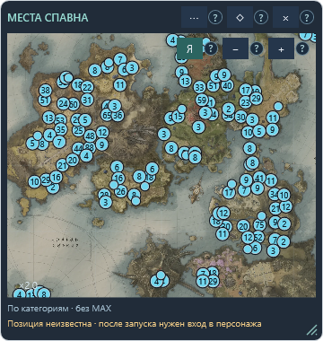
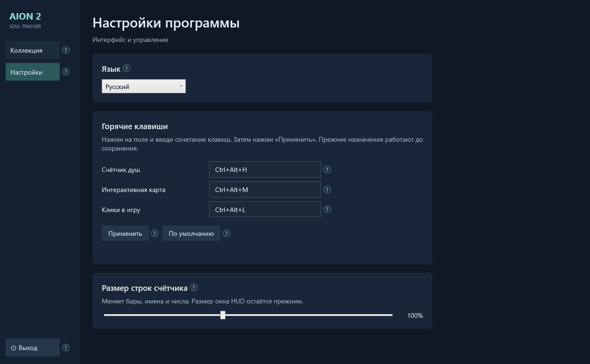

<p align="center"></p>
<h1 align="center">Aion 2 Soul Tracker</h1>
<p align="center">Коллекция душ · Компактный HUD · Интерактивная карта</p>
<p align="center"><strong>Windows 10/11 x64 · Русский / English · 0.3.0 — тестовая версия</strong></p>

Отслеживайте прогресс питомцев и выбирайте следующую цель для фарма.
Счётчик показывает оставшиеся души до MAX, а карта помогает найти места появления.


*Скриншоты используют демонстрационные данные.*

## Новое в 0.3.0

- Исправлено ложное требование входа при временном затишье сети; увеличено окно ожидания повторных TCP-пакетов.
- Выбор карты автоматический: без ручных целей и фокуса — все незавершённые по категориям.
- Крестик в строке HUD снимает цель; отмеченные цели всегда наверху каталога, даже вне фильтров.
- Числовая сортировка душ и остатка, сохраняющая направление при обновлении.
- Фокус учитывает текущую локацию. Неизвестная локация не подменяется выбранной вручную картой.
- Портреты и территории в HUD, имена и портреты в подсказках точек карты.
- 162 кибелиска: Альтгард, Морхейм, Вертерон, Элтнен; без Бездны.
- Опция автодобавления в HUD при новом получении души в известной открытой локации. Вход, сохранения и данжи цели не добавляют.

## Что умеет

| Возможность | Как работает |
| --- | --- |
| Коллекция | Категории, поиск по имени/ID, фильтры MAX и полученных питомцев |
| HUD | Отмеченные цели, количество душ и полоски прогресса; строки масштабируются независимо от окна |
| Карта | Шесть территорий, масштаб, перемещение и последняя подтверждённая позиция игрока |
| Категории на карте | Без отмеченных целей — все незавершённые из включённых категорий; с отметками — только выбранные |
| Фокус | Ближайшие к MAX одновременно в HUD и на карте; все лидеры при равенстве, следующий после завершения |
| Настройки | RU/EN, свои горячие клавиши, масштаб строк 65–150% |
| Трей | Крестик скрывает главное окно; выход — через боковую панель или меню трея |
| Справка | Наведите на кружок «?» рядом с действием |

<p> </p>

## Установка и первый запуск

Эта ветка содержит исходный код версии 0.3.0. Установщик для тестирования
`Aion2SoulTracker-Setup-v0.3.0.exe` передаёт владелец проекта; публичный релиз ещё не объявлен.

1. Запустите установщик и затем приложение с ярлыка.
2. Если появится просьба установить **Npcap**, откройте [официальный сайт](https://npcap.com/#download),
   установите драйвер с настройками по умолчанию и нажмите «Проверить снова».
3. Войдите в персонажа **после запуска трекера**. Если уже играете — вернитесь к выбору персонажа и войдите снова.
4. Включите нужные категории. Отмечайте цели в колонке HUD или включите «Режим фокуса».

Среда **.NET включена в установщик**: Python, SDK и инструменты разработчика не нужны.
Npcap устанавливается отдельно по условиям его лицензии. Для HUD используйте оконный режим игры или окно без рамки.

Установка по умолчанию: `%LOCALAPPDATA%\Programs\Aion2SoulTracker`.
Это постоянная папка программ пользователя, не временная папка.
Настройки и прогресс: `%LOCALAPPDATA%\Aion2SoulTracker` — сохраняются при обновлении и удалении.
Перед обновлением выберите **«Выход»**, чтобы полностью закрыть трекер.
Удаление: «Установленные приложения» Windows → Aion 2 Soul Tracker → «Удалить».

## Управление

| По умолчанию | Действие |
| --- | --- |
| `Ctrl+Alt+H` | Показать/скрыть счётчик |
| `Ctrl+Alt+M` | Показать/скрыть карту |
| `Ctrl+Alt+L` | Пропускать клики в игру / разрешить настройку окон |

В разделе **«Настройки»** нажмите на поле, введите сочетание и нажмите «Применить».
Если сочетание занято, программа сообщит об этом и попытается вернуть прежние назначения.
Размер окна меняется за нижний правый угол, размер строк HUD — отдельным ползунком.



## Как работает фокус

Фокус сравнивает **оставшиеся души до MAX** у незавершённых обычных питомцев
в отмеченных категориях **и в текущей локации игрока**. Например, если двоим осталось по 5 душ, видны оба.
Когда одному останется 4 — только он. После достижения MAX появится следующий.
Ручные отметки сохраняются и снова действуют после отключения фокуса.
Поиск, «Скрыть MAX» и «Только полученные» меняют каталог, не выбор фокуса.
Цели с неподтверждённым переходом уровня ждут синхронизации и временно не ранжируются.

## Ограничения тестовой версии

- Подготовлена для Aion 2 Global EU. Изменения протокола игры могут потребовать обновления.
- Точки карты — возможные места появления, а не живой список монстров.
  Координаты известны для 160 из 200 обычных питомцев.
- Позиция игрока меняется по подтверждённым координатам из игровых сообщений и может отставать.
  Возраст позиции отображается на карте.
- После потери данных требуется повторный вход в персонажа для синхронизации.

## Code signing policy

**Текущая тестовая сборка не подписана доверенным сертификатом.** Windows может показать
предупреждение о неизвестном издателе. Подготовлена поддержка подписи, но сертификат ещё не оформлен.
Статус и порядок подключения: [цифровая подпись](docs/SIGNING.md).

## Обратная связь

[Сообщить об ошибке или предложить улучшение](https://github.com/WasyaPetechkin/Aion2SoulTracker/issues/new/choose).
Укажите версию, ожидаемое и фактическое поведение, шаги повторения и скриншот.
Перед отправкой скройте имя персонажа. Не прикладывайте сетевые записи и всю папку сохранений.
Если приложение не запускается, полезен `startup-error.txt` из папки данных.

## Для разработчиков

Нужны **.NET 10 SDK** и **Inno Setup 7** для установщика.

```powershell
dotnet test tests/SoulTracker.Tests -c Release
dotnet build src/SoulTracker.App -c Release
./build.ps1
```

Если инструменты не в PATH, передайте `-DotnetPath` и `-IsccPath`.
Сборка создаёт в `dist/` установщик, portable ZIP, соответствующий source ZIP и SHA256SUMS.txt.
Исходный архив также включён в поставку приложения для воспроизводимости и соблюдения GPL.
Проверка интерфейса в интерактивной Windows-сессии:

```powershell
./dist/payload/Aion2SoulTracker.exe --verify ./qa-output
```

Она не начинает захват игры, использует синтетическую коллекцию и отдельную папку данных,
проверяет взаимодействия WPF и создаёт JSON-отчёт со скриншотами.
`--offline --data-dir <папка>` запускает приложение без захвата с отдельными сохранениями.

## English

### New in 0.3.0

- Quiet connections no longer falsely require another login; delayed TCP retransmissions have more time to recover.
- The map automatically shows all incomplete targets by category when neither manual pins nor focus are active.
- Remove a target with its HUD row’s cross. Pinned targets remain at the top of the catalogue, even outside filters.
- Soul counts and remaining souls sort numerically and retain the direction on refresh.
- Focus uses the player’s current location. Unknown locations are not replaced with the manually selected map.
- HUD portraits and territory labels; spawn tooltips with names and portraits.
- 162 kibelisks across Altgard, Morheim, Verteron and Eltnen, excluding the Abyss.
- Optional auto-pinning on new soul gains in known open-world locations. Login snapshots, saved progress and dungeons do not add targets.


A Windows soul collection tracker with a compact progress HUD and an interactive spawn map.
Install the supplied test setup, install Npcap if prompted, and log in to your character after starting the tracker.
With no pinned HUD targets, the map shows incomplete pets in enabled categories. Focus mode selects
the closest-to-MAX pets in both windows, preserves ties and advances automatically after completion.
Settings provide English/Russian, editable hotkeys and independent HUD row scale. Closing the main
window hides it to the tray; use Exit to quit. .NET is bundled. Current test builds are unsigned.
See [START-HERE.txt](START-HERE.txt) and [CHANGELOG.md](CHANGELOG.md) for more.

## Лицензии и благодарности

Исходный код: **GPL-3.0**. Независимый фанатский проект, не продукт NCSOFT.
Захват и разбор пакетов основаны на [aion2-dps-meter](https://github.com/cyberbadger6969/aion2-dps-meter).
Карты и точки импортированы из [aion2-nyerk](https://github.com/xCROv/aion2-nyerk), с указанием Questlog в исходном наборе.
Игровые изображения, названия и данные принадлежат NCSOFT и соответствующим правообладателям.
Подробности: [сторонние компоненты](licenses/THIRD-PARTY.md), [источники карт](assets/maps/SOURCES.md), [LICENSE](LICENSE).
