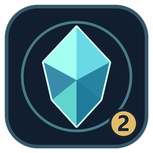
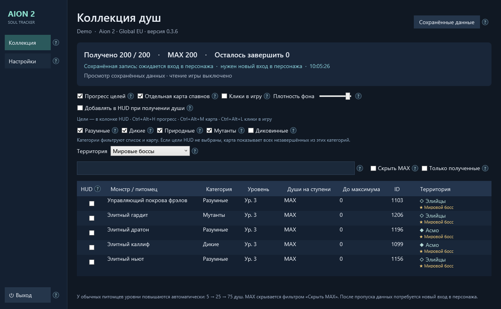
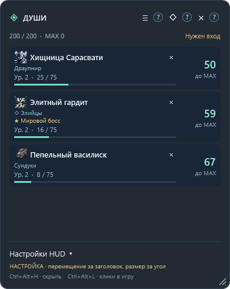
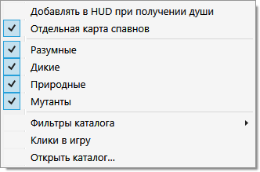

<p align="center"></p>
<h1 align="center">Aion 2 Soul Tracker</h1>
<p align="center">Коллекция душ · Компактный HUD · Интерактивная карта<br>Soul collection · Compact HUD · Interactive map</p>
<p align="center"><strong>Windows 10 / 11 x64 · Aion 2 Global EU · Русский / English</strong></p>
<p align="center"><a href="#русский">Русский</a> · <a href="#english">English</a> · <a href="https://github.com/WasyaPetechkin/Aion2SoulTracker/releases/download/v0.3.7/Aion2SoulTracker-Setup-v0.3.7.exe"><strong>Скачать / Download 0.3.7</strong></a> · <a href="#скриншоты--screenshots">Скриншоты / Screenshots</a> · <a href="https://github.com/WasyaPetechkin/Aion2SoulTracker/issues">Обратная связь / Feedback</a></p>

## Русский

Актуальная версия — **[0.3.7](https://github.com/WasyaPetechkin/Aion2SoulTracker/releases/tag/v0.3.7)**.

**Aion 2 Soul Tracker** помогает собирать души и выбирать следующую цель для фарма. Каталог показывает прогресс коллекции, компактный HUD — сколько осталось до MAX, а отдельная интерактивная карта — известные места появления монстров.

### Скачать и установить

**[Скачать установщик 0.3.7 для Windows](https://github.com/WasyaPetechkin/Aion2SoulTracker/releases/download/v0.3.7/Aion2SoulTracker-Setup-v0.3.7.exe)** · [Все версии и файлы](https://github.com/WasyaPetechkin/Aion2SoulTracker/releases)

1. Запустите `Aion2SoulTracker-Setup-v0.3.7.exe`, установите программу и откройте её с ярлыка.
2. Если приложение попросит **Npcap**, установите его с [официального сайта](https://npcap.com/#download) с настройками по умолчанию, затем нажмите «Проверить снова». Если Npcap уже установлен, повторная установка обычно не нужна.
3. Войдите в персонажа **после запуска трекера**. Если уже играете, вернитесь к выбору персонажа и войдите снова: так приложение получает начальную коллекцию.
4. Включите нужные категории и отметьте цели в колонке **HUD**. Для отображения HUD используйте оконный режим игры или окно без рамки.

**.NET уже включён** — Python, SDK и инструменты разработчика устанавливать не нужно. Npcap устанавливается отдельно. Тестовая сборка пока без цифровой подписи; Windows может показать предупреждение о неизвестном издателе.

| Файл в Releases → Assets | Для чего |
| --- | --- |
| [Aion2SoulTracker-Setup-v0.3.7.exe](https://github.com/WasyaPetechkin/Aion2SoulTracker/releases/download/v0.3.7/Aion2SoulTracker-Setup-v0.3.7.exe) | Обычная установка — рекомендуемый вариант |
| [Aion2SoulTracker-v0.3.7-portable-win-x64.zip](https://github.com/WasyaPetechkin/Aion2SoulTracker/releases/download/v0.3.7/Aion2SoulTracker-v0.3.7-portable-win-x64.zip) | Распаковать целиком в отдельную папку и запустить EXE; Npcap всё равно нужен |
| [Aion2SoulTracker-v0.3.7-source.zip](https://github.com/WasyaPetechkin/Aion2SoulTracker/releases/download/v0.3.7/Aion2SoulTracker-v0.3.7-source.zip) | Исходный код для разработчиков |
| [SHA256SUMS-v0.3.7.txt](https://github.com/WasyaPetechkin/Aion2SoulTracker/releases/download/v0.3.7/SHA256SUMS-v0.3.7.txt) | Контрольные суммы файлов |

### Что нового в 0.3.7

Обновление посвящено точности счётчика и сетевой синхронизации.

- **Защита при смене персонажа и соединения.** События старой сессии больше не могут менять текущую коллекцию.
- **Повторная доставка без двойного начисления.** Усилена обработка повторов и восстановления пропущенных пакетов.
- **Сетевая пауза не равна потере данных.** Обычное затишье и посторонний трафик сами по себе не сбрасывают синхронизацию.
- **Явное ожидание синхронизации при реальной потере.** Счётчик не продолжает выдавать неподтверждённые значения за актуальные.

При невосстановимой потере данных или новом соединении без полной коллекции может понадобиться повторный вход в персонажа. Длительная проверка новой версии с VPN и LagoFast продолжается.

[Описание и файлы релиза 0.3.7](https://github.com/WasyaPetechkin/Aion2SoulTracker/releases/tag/v0.3.7)

**Ранее, в 0.3.6:** удалён режим фокуса за ненадобностью — автор не нашёл в нём практической пользы и целесообразности. Добавлены источники душ в подземельях, метки мировых боссов и автодобавление целей в HUD в данжах.

### LagoFast и другие ускорители

В 0.3.5 исправлено чтение игровых соединений через локальный посредник LagoFast. Трекер автоматически определяет его порт и использует Loopback. Проверены вход в персонажа и обновление счётчика душ через LagoFast. Запускайте трекер до входа в персонажа; при обновлении полностью закройте старую версию.

Другие ускорители с похожим устройством могут работать, однако отдельно не проверены.

### Возможности

| Функция | Как работает |
| --- | --- |
| Каталог | Русские и английские имена, поиск по имени/ID, категории, фильтры полученных и MAX |
| Источники душ | Территории, названия данжей, мировые боссы и сундуки; доступны и для завершённых питомцев |
| Отмеченные цели | Всегда сверху каталога, даже если не соответствуют текущему поиску или фильтрам |
| HUD | Портрет, название, территория, прогресс и остаток душ; крестик в строке снимает ручное отслеживание |
| Карта | Шесть территорий, масштабирование, перемещение, точки спавна и последняя подтверждённая позиция игрока |
| Подсказки карты | Наведение на точку показывает имя и портрет; при плотном расположении точки объединяются |
| Кибелиски | 162 точки на картах Альтгарда, Морхейма, Вертерона и Элтнена; в Бездне не отображаются |
| Автодобавление | При включённой галочке новое получение души добавляет незавершённую цель в HUD, включая данжи |
| Настройки | RU/EN, свои горячие клавиши, прозрачность фона, независимый масштаб строк HUD 65–150% |
| Трей и справка | Крестик главного окна сворачивает его в трей; кружки «?» объясняют настройки |

### Выбор целей

- **Нет ручных целей:** карта автоматически показывает всех незавершённых из включённых категорий.
- **Есть ручные цели:** карта сужается до них; категории продолжают действовать. Снять цель можно в каталоге или крестиком в её строке HUD.
- **«Добавлять в HUD при получении души» нужно включить отдельно.** Новая душа добавляет незавершённую цель в любой локации, включая подземелья. Вход в персонажа и загрузка сохранений не добавляют цели.
- Поиск, «Скрыть MAX» и «Только полученные» фильтруют каталог; отмеченные цели остаются видимыми. Категории также влияют на карту.

### Где добывать души

Колонка **«Территория»** и строка HUD показывают территорию или название подземелья. Наведите мышь, чтобы увидеть полный список мест. Для мобов с подтверждённым мировым боссом среди источников есть метка **★ Мировой босс**; его имя указано в подсказке. Боссы данжей такую метку не получают.

В фильтре **«Территория»** доступны Асмодиане, Элийцы, Бездна, **Подземелья**, **Мировые боссы**, **Сундуки питомцев** и другие источники. Фильтр меняет только каталог; отмеченные цели остаются видимыми. Для просмотра завершённого моба снимите **«Скрыть MAX»** и найдите его по имени или ID.

База обновлена 6 ноября 2026: места добычи известны для 177 обычных питомцев, включая 65 с источниками в подземельях. Для ещё 23 указаны подтверждённые сундуки получения питомца. Сундук — способ получить питомца, а не подтверждение выпадения его души с монстра. Отсутствующие места не подставляются по догадке.

Интерактивная карта по-прежнему содержит шесть открытых территорий и точки для 160 питомцев. Карты подземелий пока не включены: их названия видны в каталоге, HUD и подсказке пустой карты при выборе одной цели. Данные базы могут отличаться от доступного контента конкретного сервера.

### Настройки прямо в HUD

Внизу счётчика нажмите **«Настройки HUD ▾»**. Здесь доступны автодобавление при получении души, категории, показ карты и «Клики в игру». В подменю «Фильтры каталога» — диковинные, «Скрыть MAX» и «Только полученные». Изменения сразу синхронизируются с главным окном. Категории влияют на карту; фильтры каталога — только на список в основном окне.

Подсказки меню переносятся на строки и закрываются при уходе мыши, выборе пункта или закрытии меню.

Если меню не нажимается, отключите «Клики в игру» сочетанием `Ctrl+Alt+L` (или своим назначенным сочетанием).

### Управление

| По умолчанию | Действие |
| --- | --- |
| `Ctrl+Alt+H` | Показать / скрыть HUD |
| `Ctrl+Alt+M` | Показать / скрыть карту |
| `Ctrl+Alt+L` | Пропускать клики в игру / разрешить управление окнами |
| Колесо мыши над картой | Изменить масштаб |
| Перетаскивание карты | Переместить обзор |
| Кнопка «Я» | Следовать за последней подтверждённой позицией игрока |
| Кнопка «⋯» карты | Открыть выбор территории и целей |

Горячие клавиши меняются в разделе **«Настройки»** кнопкой «Применить». Размер окон меняется за нижний правый угол. Чтобы нажимать кнопки HUD и видеть подсказки карты, отключите режим «Клики в игру».

### Обновление и сохранения

Полностью закройте старую версию через **«Выход»**, затем запустите новый установщик и выберите прежнюю папку. После запуска трекера снова войдите в персонажа.

- Программа: `%LOCALAPPDATA%\Programs\Aion2SoulTracker` — постоянная папка программ пользователя, не временная.
- Настройки и прогресс: `%LOCALAPPDATA%\Aion2SoulTracker` — хранятся отдельно и не удаляются установщиком при обновлении или удалении программы.
- Удаление: «Установленные приложения» Windows → Aion 2 Soul Tracker.

### Частые вопросы

**Почему написано «нужен вход»?** При старте нужна начальная коллекция. После подтверждённой потери данных тоже требуется повторный вход в персонажа. Временная пауза сама по себе не должна сбрасывать синхронизацию. В 0.3.7 усилены привязка коллекции к персонажу и соединению, обработка потерь и повторной доставки. Если новый поток не содержит полной коллекции, счётчик ожидает подтверждённой синхронизации.

**Души считаются, но цели не добавляются автоматически?** Проверьте галочку «Добавлять в HUD при получении души». Автодобавление выключено по умолчанию, работает и в данжах и не добавляет уже завершённые цели.

**Почему нет точек или отстаёт игрок?** Координаты известны не для всех монстров: сейчас есть места появления для 160 из 200 обычных питомцев. Позиция игрока обновляется по подтверждённым игровым сообщениям и может отставать; её возраст указан на карте. Точки показывают возможные места появления, а не наличие живого монстра.

**Почему после крестика приложение осталось запущено?** Главное окно сворачивается в трей. Для полного закрытия используйте «Выход» слева или в меню значка трея.

### Обратная связь

[Сообщить об ошибке или предложить улучшение](https://github.com/WasyaPetechkin/Aion2SoulTracker/issues). Напишите версию программы, локацию, что ожидали, что произошло и как повторить. Скриншот поможет; перед отправкой скройте имя персонажа. Не публикуйте сетевые записи и всю папку сохранений. При проблемах запуска полезен `startup-error.txt` из папки данных.

---

## English

Current release: **[0.3.7](https://github.com/WasyaPetechkin/Aion2SoulTracker/releases/tag/v0.3.7)**.

**Aion 2 Soul Tracker** helps you collect souls and choose your next farming target. The catalogue tracks your collection, a compact HUD shows souls remaining to MAX, and a separate interactive map displays known monster spawn locations.

### Download and install

**[Download the Windows installer 0.3.7](https://github.com/WasyaPetechkin/Aion2SoulTracker/releases/download/v0.3.7/Aion2SoulTracker-Setup-v0.3.7.exe)** · [All versions and files](https://github.com/WasyaPetechkin/Aion2SoulTracker/releases)

1. Run `Aion2SoulTracker-Setup-v0.3.7.exe`, install the application and open its shortcut.
2. If prompted for **Npcap**, install it from the [official website](https://npcap.com/#download) with the default options, then click “Check again”. An existing Npcap installation usually does not need reinstalling.
3. Log in to your character **after starting the tracker**. If already playing, return to character selection and log in again so the tracker receives your initial collection.
4. Enable your categories and pin targets in the **HUD** column. Use windowed or borderless game mode for the HUD.

**.NET is bundled** — no Python, SDK or development tools are needed. Npcap is installed separately. This test build is unsigned; Windows may display an unknown publisher warning.

| File under Releases → Assets | Purpose |
| --- | --- |
| [Aion2SoulTracker-Setup-v0.3.7.exe](https://github.com/WasyaPetechkin/Aion2SoulTracker/releases/download/v0.3.7/Aion2SoulTracker-Setup-v0.3.7.exe) | Standard installation — recommended |
| [Aion2SoulTracker-v0.3.7-portable-win-x64.zip](https://github.com/WasyaPetechkin/Aion2SoulTracker/releases/download/v0.3.7/Aion2SoulTracker-v0.3.7-portable-win-x64.zip) | Extract the entire archive to a separate folder and run the EXE; Npcap is still required |
| [Aion2SoulTracker-v0.3.7-source.zip](https://github.com/WasyaPetechkin/Aion2SoulTracker/releases/download/v0.3.7/Aion2SoulTracker-v0.3.7-source.zip) | Source code for developers |
| [SHA256SUMS-v0.3.7.txt](https://github.com/WasyaPetechkin/Aion2SoulTracker/releases/download/v0.3.7/SHA256SUMS-v0.3.7.txt) | File checksums |

### What's new in 0.3.7

This update focuses on counter accuracy and network synchronization.

- **Protection across character and connection changes.** Events from a retired session cannot modify the current collection.
- **Retransmission without double counting.** Strengthened handling of repeated packets and recovery of missing ranges.
- **A network pause is not data loss.** Ordinary quiet periods and unrelated traffic do not reset synchronization on their own.
- **Explicit synchronization status after actual loss.** The counter does not keep presenting unconfirmed values as current.

Unrecoverable data loss or a new connection without a complete collection may still require another character login. Extended testing of this version with VPN and LagoFast is ongoing.

[Release notes and files for 0.3.7](https://github.com/WasyaPetechkin/Aion2SoulTracker/releases/tag/v0.3.7)

**Previously, in 0.3.6:** focus mode was removed as unnecessary because the author found no practical benefit or sufficient reason to keep it. Added dungeon soul sources, world boss labels and automatic HUD pinning in dungeons.

### LagoFast and other accelerators

Version 0.3.5 fixes capture through the LagoFast local relay. The tracker automatically detects its port and uses Loopback. Character login and soul counter updates have been verified with LagoFast. Start the tracker before logging in to your character; fully exit the old version before updating.

Other accelerators using a similar relay may work but have not been tested separately.

### Features

| Feature | How it works |
| --- | --- |
| Catalogue | Russian and English names, name/ID search, categories, owned and MAX filters |
| Soul sources | Territories, dungeon names, world bosses and chests; also available for completed pets |
| Pinned targets | Always at the top, even outside the current search or filters |
| HUD | Portrait, name, territory, progress and souls remaining; each row’s cross removes a manual target |
| Map | Six territories, zooming, panning, spawn points and the last confirmed player position |
| Map tooltips | Hover a point for its name and portrait; nearby points are grouped |
| Kibelisks | 162 locations across Altgard, Morheim, Verteron and Eltnen; excluded from the Abyss |
| Auto-pinning | When enabled, a newly received soul adds its incomplete target to the HUD, including dungeons |
| Settings | RU/EN, editable hotkeys, background opacity and independent HUD row scale of 65–150% |
| Tray and help | Closing the main window hides it to the tray; “?” badges explain settings |

### Target selection

- **No manual targets:** the map automatically shows all incomplete targets in enabled categories.
- **Manual targets selected:** the map narrows to them; categories still apply. Unpin a target in the catalogue or with its HUD row cross.
- **Enable “Add to HUD when a soul is received” separately.** A new soul adds its incomplete target in any location, including dungeons. Character login and loading saved progress do not add targets.
- Search, “Hide MAX” and “Owned only” filter the catalogue; pinned targets remain visible. Categories also affect the map.

### Where to farm souls

The **Territory** column and HUD row show a territory or dungeon name. Hover to see the full location list. Pets with a confirmed world boss among their sources have a **★ World boss** label; its name is shown in the tooltip. Dungeon bosses do not receive this label.

The **Territory** filter offers Asmodians, Elyos, Abyss, **Dungeons**, **World bosses**, **Pet chests** and other sources. It affects only the catalogue; pinned targets remain visible. To look up a completed pet, disable **Hide MAX** and search by name or ID.

Data refreshed on 6 November 2026: documented farming locations for 177 regular pets, including 65 with dungeon sources. Another 23 list confirmed pet acquisition chests. A chest is a way to acquire a pet, not evidence that its soul drops from a monster. Missing locations are not guessed.

The interactive map still contains six open-world territories and points for 160 pets. Dungeon maps are not included yet: their names appear in the catalogue, HUD and empty-map guidance for a single selected target. Database content may differ from content available on a particular server.

### Settings directly in the HUD

Click **“HUD settings ▾”** at the bottom of the counter. It provides automatic soul tracking, categories, map visibility and click through. The “Collection filters” submenu contains special pets, “Hide MAX” and “Owned only”. Changes immediately synchronize with the main window. Categories affect the map; collection filters affect only the main catalogue.

Menu tooltips wrap and close when the pointer leaves, an item is selected or the menu closes.

If the menu does not respond, disable click through with `Ctrl+Alt+L` (or your custom shortcut).

### Controls

| Default | Action |
| --- | --- |
| `Ctrl+Alt+H` | Show / hide HUD |
| `Ctrl+Alt+M` | Show / hide map |
| `Ctrl+Alt+L` | Pass clicks through to the game / enable window controls |
| Mouse wheel over the map | Zoom |
| Drag the map | Pan |
| “Me” button | Follow the last confirmed player position |
| Map “⋯” button | Open territory and target selection |

Change hotkeys in **Settings**, then click “Apply”. Resize windows using their bottom-right corners. Disable “Click through” to use HUD buttons and map tooltips.

### Updates and saved data

Fully close the old version using **Exit**, run the new installer and select the same folder. After starting the tracker, log in to your character again.

- Application: `%LOCALAPPDATA%\Programs\Aion2SoulTracker` — a permanent per-user application folder, not a temporary folder.
- Settings and progress: `%LOCALAPPDATA%\Aion2SoulTracker` — stored separately and not removed by the installer during upgrades or uninstalling.
- Uninstall through Windows Settings → Installed apps → Aion 2 Soul Tracker.

### Frequently asked questions

**Why does it say “login required”?** Starting capture requires an initial collection. Confirmed data loss also requires another character login. A temporary pause alone should not reset synchronization. Version 0.3.7 strengthens collection ownership across character and connection changes, loss handling and retransmission recovery. If a new stream does not contain a complete collection, the counter waits for confirmed synchronization.

**Souls are counted, but targets are not added automatically?** Check “Add to HUD when a soul is received”. It is off by default, works in dungeons too and does not add completed targets.

**Why are points missing or the player marker delayed?** Some monsters have no known coordinates: the dataset currently covers 160 of 200 regular pets. The player marker uses confirmed game messages and can lag; its age is shown on the map. Spawn points indicate possible locations, not currently living monsters.

**Why is the app still running after clicking X?** The main window hides to the tray. Use Exit in the sidebar or tray menu to quit completely.

### Feedback

[Report a bug or suggest an improvement](https://github.com/WasyaPetechkin/Aion2SoulTracker/issues). Include the app version, location, expected and actual behaviour, and reproduction steps. Screenshots help; hide your character name first. Do not publish network recordings or your entire saved-data folder. For startup problems, `startup-error.txt` in the data folder may help.

---

## Скриншоты / Screenshots

Демонстрационные данные сборки 0.3.6 / Demonstration data from build 0.3.6.


<p> </p>

## Исходный код и сборка / Source and build

[Исходный код 0.3.7 / Version 0.3.7 source](https://github.com/WasyaPetechkin/Aion2SoulTracker/tree/v0.3.7) · [Скачать исходники / Download source](https://github.com/WasyaPetechkin/Aion2SoulTracker/releases/download/v0.3.7/Aion2SoulTracker-v0.3.7-source.zip)

Ветка `main` содержит главную страницу проекта. Для сборки приложения выберите тег `v0.3.7` или распакуйте архив исходников; `source.zip` также включён в дистрибутив. / The `main` branch contains the project landing page. To build the app, use the `v0.3.7` tag or extract the source archive; `source.zip` is also bundled with the distribution.

Для сборки нужны .NET 10 SDK и Inno Setup 7. / Building requires .NET 10 SDK and Inno Setup 7.

```powershell
git clone --branch v0.3.7 https://github.com/WasyaPetechkin/Aion2SoulTracker.git
cd Aion2SoulTracker
dotnet test tests/SoulTracker.Tests -c Release
dotnet build src/SoulTracker.App -c Release
./build.ps1
```

Результаты находятся в `dist/`. Можно передать `-DotnetPath` и `-IsccPath`, если инструменты не в PATH. / Outputs are in `dist/`. Use `-DotnetPath` and `-IsccPath` if the tools are not on PATH.

## Лицензия и благодарности / License and credits

**GPL-3.0.** Независимый фанатский проект, не официальный продукт NCSOFT. / An independent fan project, not an official NCSOFT product.

- Захват и разбор пакетов / Capture and parsing: [aion2-dps-meter](https://github.com/cyberbadger6969/aion2-dps-meter).
- Карты, данные и портреты / Maps, data and portraits: [aion2-nyerk](https://github.com/xCROv/aion2-nyerk), [Questlog](https://questlog.gg/aion-2/en/map).
- Игровые изображения, названия и данные принадлежат соответствующим правообладателям. / Game artwork, names and data belong to their respective owners.
- [Лицензия / License](https://github.com/WasyaPetechkin/Aion2SoulTracker/blob/v0.3.7/LICENSE) · [Сторонние компоненты / Third-party notices](https://github.com/WasyaPetechkin/Aion2SoulTracker/blob/v0.3.7/licenses/THIRD-PARTY.md).

Тестовая версия для Global EU; обновления игры могут потребовать обновления трекера. / A test version for Global EU; game updates may require tracker updates.

